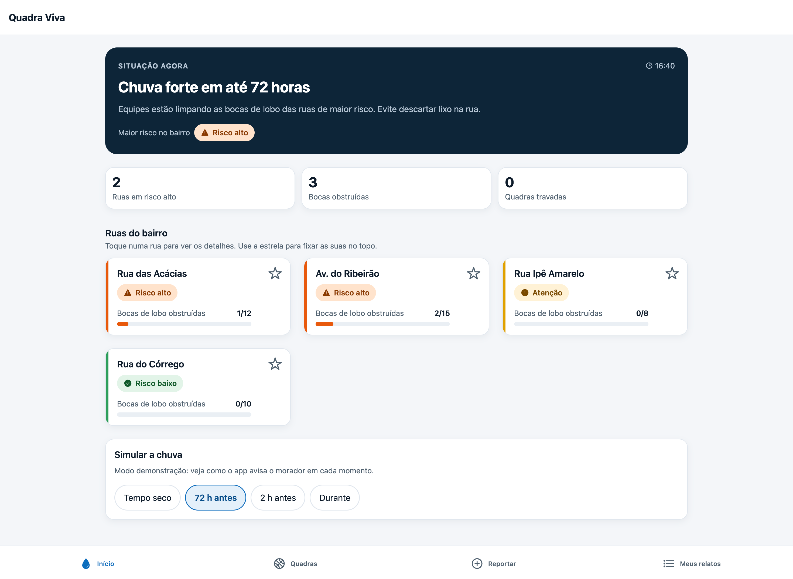
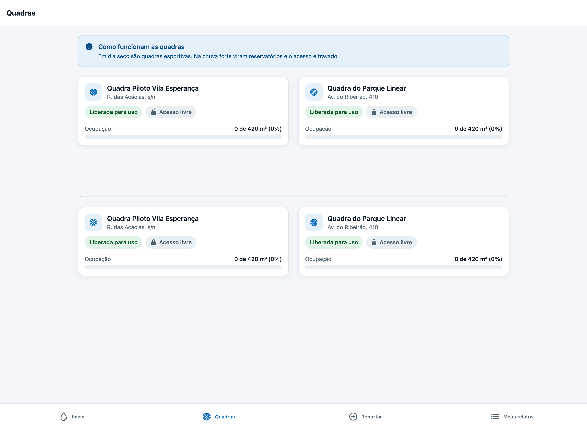
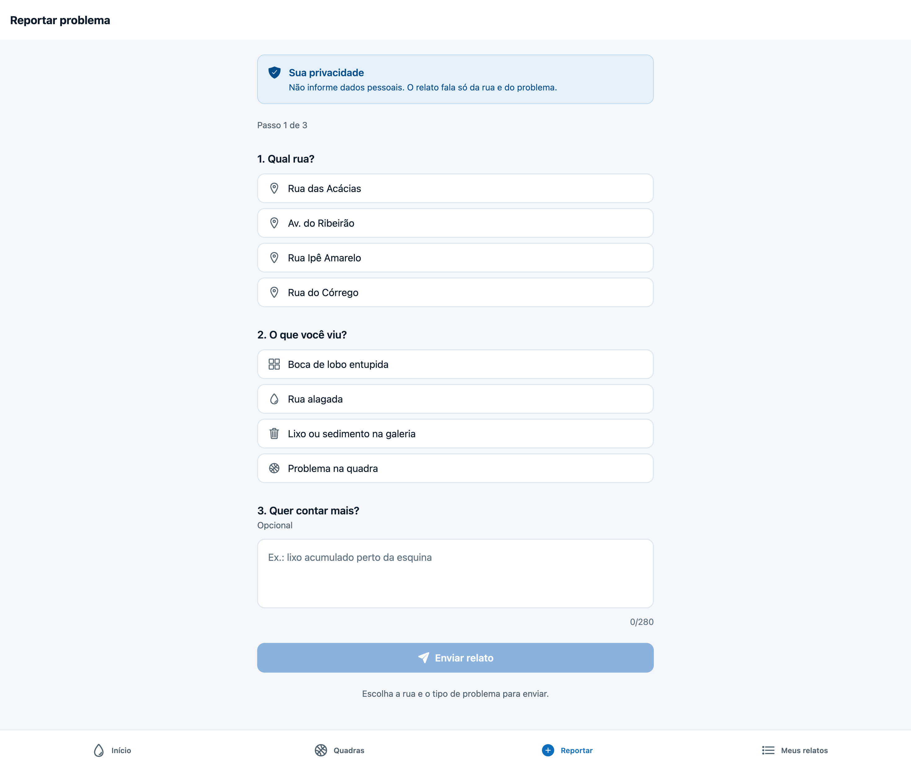
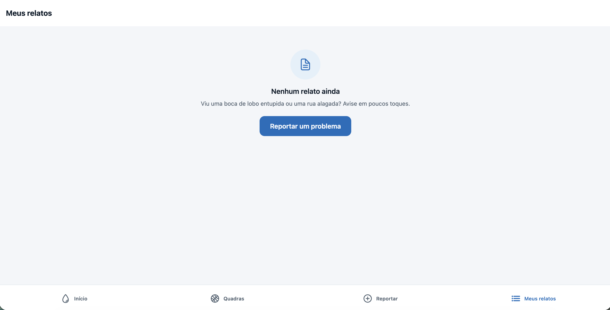
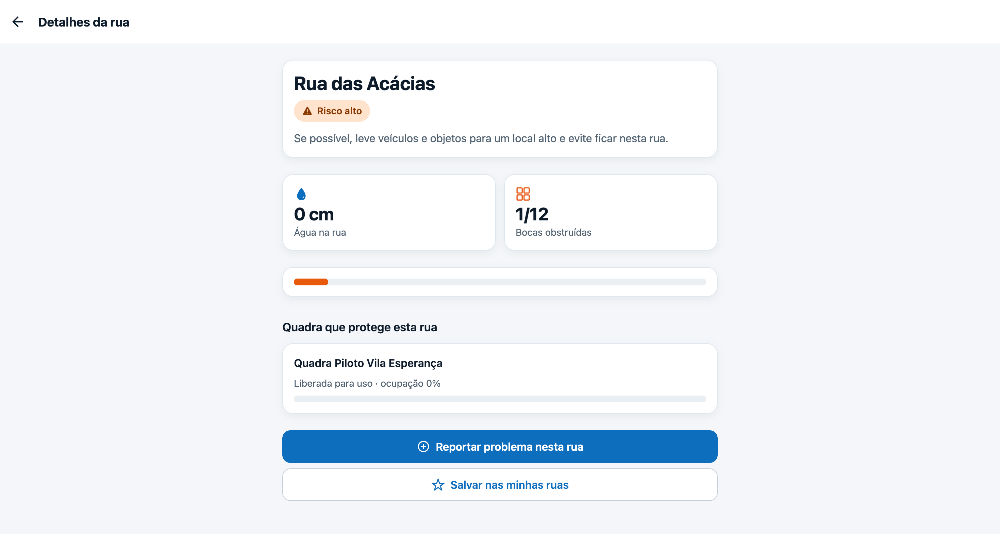

# Quadra Viva — App mobile (Mobile Development & IoT)

App em **React Native + TypeScript + Expo Router** que é a porta de entrada do cidadão na CitizenTech *Quadra Viva*: ele consulta o risco de alagamento da sua rua, acompanha as quadras-reservatório e reporta problemas de drenagem.

## Ficha da CitizenTech

| Campo | Resposta |
|---|---|
| **Nome da CitizenTech** | Quadra Viva |
| **Cidade e bairro** | São Paulo (SP), Vila Madalena: bairro proposto para o piloto. Os dados do app são simulados. |
| **Cidadão beneficiado** | Morador de rua/bairro com alagamento recorrente e a Defesa Civil local |
| **Problema, em uma frase** | Moradores só descobrem o alagamento depois que a rua já alagou, porque bocas de lobo entupidas e a resposta tardia não são avisadas com antecedência. |
| **Como funciona** | Sensores nas bocas de lobo + previsão de curto prazo + atuadores (comportas, quadras, robôs) agem antes da chuva. A quadra pública vira reservatório no pico da chuva. O app mostra o risco por rua em cada fase do evento (72 h antes, 2 h antes, durante) e recebe relatos dos moradores. |
| **O que cada parte faz** | **Mobile (esta pasta):** consulta de risco/quadras e registro de relatos. **IoT/ESP32:** sensor de nível na boca de lobo. **IA/ML:** previsão de alagamento. **Backend (SOA/C#):** API de snapshots e relatos. **Infra (OS):** hospedagem. **Cyber:** proteção de dados. **QA:** requisitos e testes. |
| **Link do repositório** | https://github.com/lucasserrano10/GlobalSolution-2026-nov |
| **Indicador de impacto** | % de alagamentos previstos e antecedência do alerta; bocas de lobo desobstruídas antes da chuva; redução da lâmina d'água nas ruas monitoradas. |
| **ODS conectados** | **11** Cidades e comunidades sustentáveis (reduz risco e danos de alagamentos); **13** Ação contra a mudança global do clima (adaptação a chuvas extremas); **9** Indústria, inovação e infraestrutura (drenagem inteligente e resiliente). |

## Jornada principal do cidadão

1. Abre o app e vê a **situação agora** e o risco de cada rua (**Início**).
2. Toca numa rua para ver bocas de lobo obstruídas, água na rua e a quadra que a protege (**Detalhe da rua**).
3. Confere se a quadra está liberada, travada ou retendo água (**Quadras**).
4. Vê algo errado e faz um relato em 3 passos, mesmo sem internet (**Reportar**).
5. Acompanha, reenvia ou exclui seus relatos (**Meus relatos**).

## Telas e navegação (Expo Router)

```
src/
├── app/                       Rotas (Expo Router)
│   ├── _layout.tsx            Stack raiz + providers (feedback, dados)
│   ├── (tabs)/                Tabs: Início · Quadras · Reportar · Meus relatos
│   └── rua/[id].tsx           Detalhe da rua (rota dinâmica)
├── components/
│   ├── ui/                    Design system (Text, Button, Card, Badge, Choice, ProgressBar,
│   │                          Notice, EmptyState, Skeleton, Grid, Screen, Feedback)
│   └── *.tsx                  Componentes de domínio (RuaCard, QuadraCard, RelatoCard, …)
├── constants/theme.ts         Tokens: cores, espaçamento, raios, tipografia, sombras, risco
├── hooks/                     useLayout, useReducedMotion, useRelatos
├── services/                  api.ts (mock/API) e relatos.ts (salvar + enviar)
├── db/database.ts             SQLite local
├── state/                     Contexto de dados do bairro
└── data/ · utils/             Tipos, regras de risco e formatação
```

Fluxo do morador: **Início** → toca numa rua → **Detalhe** → “Reportar problema nesta rua” (já com a rua escolhida) → **Meus relatos**.

## Design system

Tudo vive em [`src/constants/theme.ts`](src/constants/theme.ts) e [`src/components/ui/`](src/components/ui):

- **Cores:** azul-petróleo como primária, tinta escura para o destaque da situação e tons semânticos (sucesso, aviso, perigo).
- **Tipografia:** escala `display / title / heading / body / caption / overline / stat`, com `lineHeight` definido.
- **Espaçamento e raios:** escala de 4 a 32 dp e raios 8 a 22.
- **Componentes:** botões (primário, secundário, ghost, perigo), cards, badges, opções selecionáveis, barras de progresso, avisos, estados vazios, skeletons, toast e diálogo de confirmação.
- **Movimento:** animações sutis (escala ao tocar, barra de progresso, toast, skeleton) que respeitam “reduzir movimento” do sistema.
- **Responsividade:** `Screen` limita a largura e centraliza; `Grid` usa 1 coluna no celular, 2 no tablet e 3 em telas largas.

## Consumo de dados

[`src/services/api.ts`](src/services/api.ts) consome uma API **ou** um mock:

- Sem configuração: usa **mock local** com dados **simulados** (sem dados pessoais) para os 4 momentos do evento de chuva: `seco`, `previsao` (72 h), `confirmado` (2 h) e `durante`.
- Com `EXPO_PUBLIC_API_URL` definida: usa `GET {URL}/snapshot?cenario=...` e `POST {URL}/relatos` (use HTTPS; timeout de 8 s).

Na tela **Início**, a seção “Simulação” alterna o cenário para a demonstração.

## Banco de dados (SQLite local, `expo-sqlite`)

[`src/db/database.ts`](src/db/database.ts) cria o banco `quadraviva.db` com:

- `relatos` — CRUD completo (criar, listar, marcar como enviado, excluir). Funciona offline: se o envio falhar, o relato fica **pendente** e pode ser reenviado.
- `ruas_favoritas` — ruas que o morador quer acompanhar (aparecem primeiro).

## Acessibilidade e inclusão

- Alvos de toque ≥ 48 dp, fontes ≥ 14 pt, cores de alto contraste.
- O risco nunca depende só da cor: sempre há **ícone + texto**.
- `accessibilityRole`, `accessibilityLabel`, `accessibilityHint` e `accessibilityState` nos controles; barras de progresso com `accessibilityValue`.
- Linguagem simples, telas pequenas e fluxo curto. Há skeletons de carregamento, estados vazios com ação, avisos de erro com “Tentar de novo”, pull-to-refresh e confirmação antes de excluir.
- Mensagens de sucesso e erro aparecem em toast anunciado por leitores de tela.
- Funciona sem rede (relatos e favoritas ficam no celular).
- Privacidade: não há login nem campo de dado pessoal; o formulário avisa para não informar dados pessoais.

## Como rodar

Requisitos: Node 20+ e o app **Expo Go** no celular (ou emulador Android/iOS).

```bash
cd mobile
npm install
npx expo start
```

Escaneie o QR code com o Expo Go. Para usar uma API real:

```bash
EXPO_PUBLIC_API_URL=https://sua-api.exemplo.com npx expo start
```

Validação: `npx tsc --noEmit` e `npx eslint src`.

> O alvo é Android/iOS. O banco usa `expo-sqlite` e não foi configurado para web.

## Prints das telas

| Início | Quadras |
|---|---|
|  |  |

| Reportar | Meus relatos |
|---|---|
|  |  |

| Detalhe da rua |
|---|
|  |

## Vídeo de demonstração (até 3 min)

**Link:** https://www.youtube.com/watch?v=q2uuUyRqxJk


## Integrantes

- Lucas Serrano, RM 555170
- David Murillo, RM 559078
- Ana Clara, RM 559021
- Yasmin Gonçalves, RM 559147

## Dados e IA

Todos os dados são **simulados**, baseados no resumo técnico da proposta (quadra de 420 m², fases 72 h / 2 h / durante).
